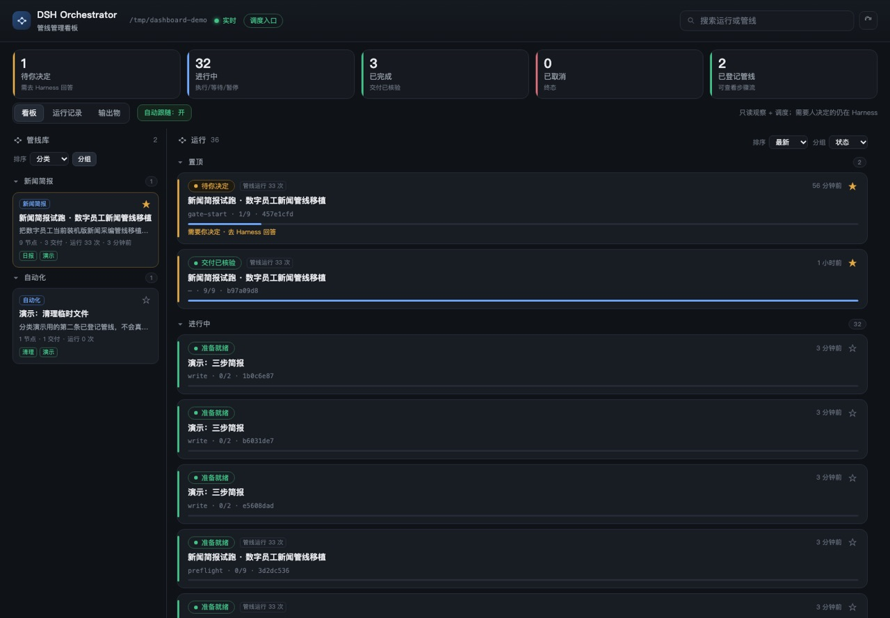
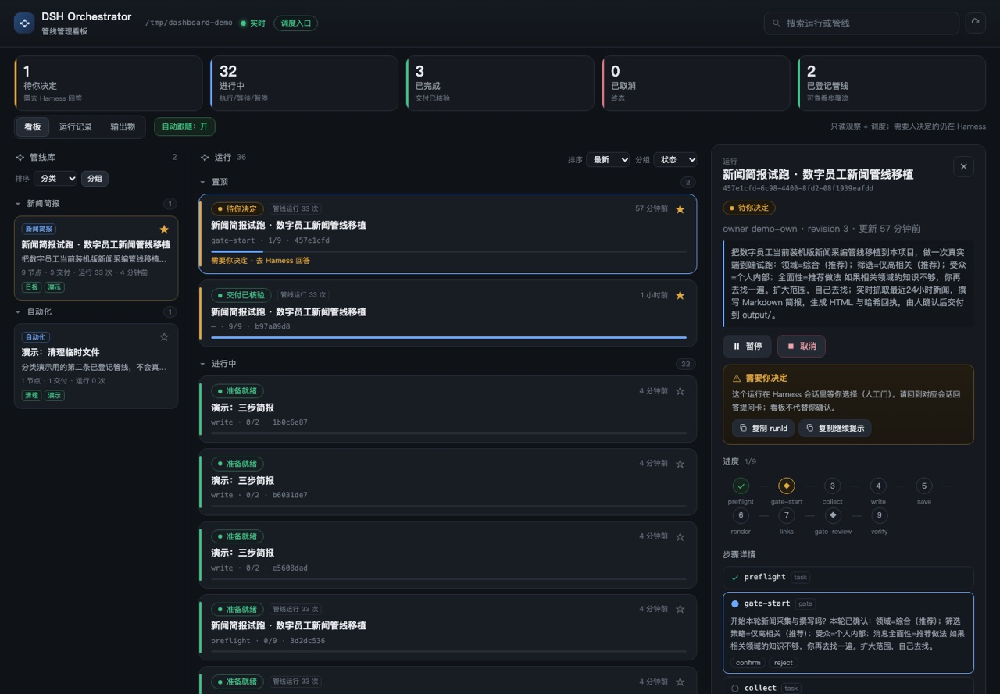
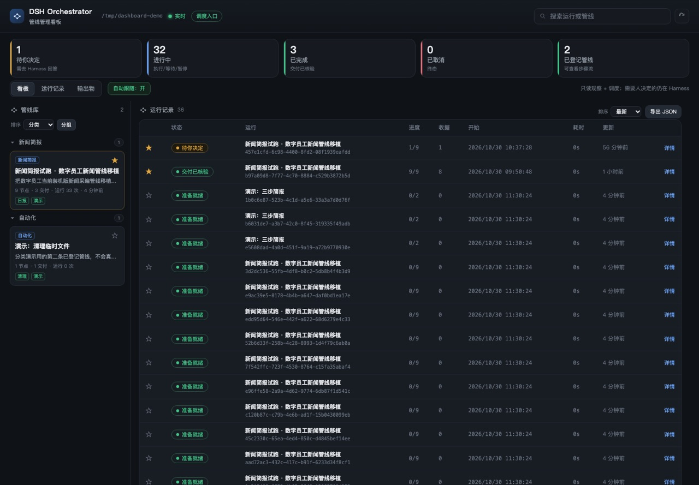
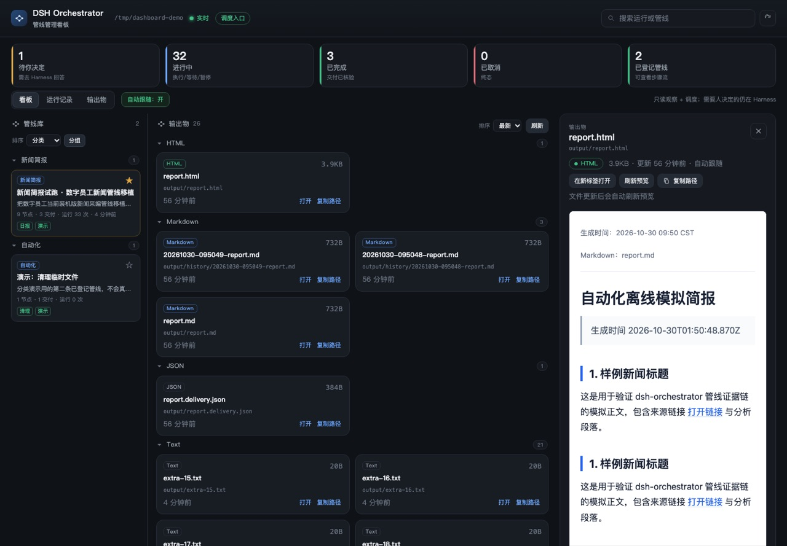

# DSH Orchestrator

**简体中文** | [English](README.en.md)

把确认过的意图组织成可观察、可验证、可恢复的管线。独立核心首先通过 DeepSeek Harness 插件交付。

**当前为开发预览。** 核心与插件适配已具备可运行代码。真实模型与真实界面的三个主要场景已在 `66d252f` 验证；修复提交 `67e0f7c`（取消后对账修复）上追加的真实界面反例（拒绝、无答案、缺交付、在途取消、对账 verified 回归、人工门拒绝）已通过。三条主要场景未在修复提交后重跑、确认卡为受托验收操作者代点等边界见[当前状态](STATUS.md)和[验证记录](docs/sdlc/test/verification.md)。

## 界面截图

看板（`orch view`）开发预览：总览、运行记录、输出物内嵌预览与运行详情抽屉。截图使用隔离演示工作区（36 个运行、2 条登记管线、26 个输出物，合成数据，不是真实新闻）；完整尺寸、窄屏与说明见[看板 v5 证据](docs/evidence/2026-10-30-dashboard-v5/README.md)。

<table>
  <tr>
    <td width="50%"></td>
    <td width="50%"></td>
  </tr>
  <tr>
    <td></td>
    <td></td>
  </tr>
</table>

看板是可观察、可筛选、可调度的只读管理面；意图确认、人工门与对账仍在 Harness 会话内由人完成。

## 方法

- 人的话是原始输入；AI引导梳理并复述，经人确认才建立正式Intent。
- 定义说明方法，运行固定版本，具体权限沿用宿主实际机制。
- AI需要判断时使用宿主Agent，确定的工作可由可信脚本驱动；关键取舍由人决定。
- 任务派发先持久化操作编号。中断后先读回状态，不自动重复未知副作用。
- 模型回报完成后，独立检查声明的文件产物；运行结束与交付合格分别判断。
- `harness.userQuestions` 表示答复经过宿主提问通道，不能单凭它证明具体是谁点击；需要区分本人和受托代操作时，应使用额外身份与审计机制。

方法来自数字员工的管线实践；本仓原创实现，不要求安装数字员工。与[起飞](https://github.com/8778fkv694-hub/pre-flight)衔接：起飞建立AGENT、Intent、Spec与Plan，管线引用相关路径并固定内容摘要。

## 快速开始（零配置）

```bash
npm run quickstart
```

它会在本机创建/重置 `.demo-workspace/`（合成演示数据，不调用模型、不读凭据、不改你的主 profile），生成示例管线、几个不同状态的运行与输出物，然后启动只读+调度的看板并打印带 token 的本机 URL。按 `Ctrl+C` 停止。

- 换端口：`npm run quickstart -- --port 8892`
- 自动打开系统浏览器（默认不自动弹）：`npm run quickstart -- --open`
- 只用只读：`npm run quickstart -- --read-only`
- 真实项目：`orch view <你的工作区>`（或 `node src/viewer.js <工作区>`）

要求 Node 22+；仓库无运行依赖。失败时会给出人话原因（Node 版本、端口占用、工作区不可写等）。

## 在 Harness 里一句话调用

插件注册的是工具，不是 slash command；你只要在会话里说目标，Agent 会调用 `orch_*`。为了让常用流程更稳，仓库自带一个 DSH skill：

```bash
mkdir -p <工作区>/.agents/skills
cp -R skills/dsh-orchestrator <工作区>/.agents/skills/
```

之后可以这样说：

- “按新闻简报管线跑一份今天的简报，四项偏好问我。”
- “看一下刚才那条运行到哪了；需要我决定就弹卡片。”
- “把这个运行暂停/继续；外部动作不确定时先对账。”

Skill 里含建管线、取工作单、人工门、暂停/继续/取消/对账、看板与失败纪律的标准配方；它不改变权限，也不允许模型代点人工门。

## 常见问题

参数化模板示例：`node src/cli.js instantiate examples/parameterized-template.json > /tmp/review-pipeline.json`。可再给一个参数 JSON 文件作为第三个参数；支持有边界的整数和字符串/枚举，未知参数报错。每次实例化生成独立 `runKey`，交付路径必须位于 `output/<runKey>/` 或 `artifacts/<runKey>/`，本次参数写进候选意图供确认。它只输出定义，不执行任务、不默认为已确认；如需沿用偏好，显式复用上次的参数文件，仍确认本次定义。参数不是 shell 转义或命令授权。

先运行只读诊断：`node src/cli.js doctor <工作区>`（或已安装后的 `orch doctor <工作区>`；机器可读输出加 `--json`）。它不会建立运行；宿主插件加载与会话工作区无法仅凭本地文件确认，会明确标为 `unknown`。

运行详情现在显示所属会话、显式接手记录、最后状态事件、工作单时长、当前证据缺项，以及“复制到所属会话继续处理”。新版本增加 `orch_claim(run, operation)`：宿主会话在确认从未执行的新工作单上记录接手，再执行并提交证据；中断或未知效果先对账。接手不等于执行许可、执行端心跳或完成。旧运行兼容；旧插件需更新后才有新工具，本看板不会自动发送消息或代执行任务。

| 现象 | 原因与处理 |
|---|---|
| `quickstart` 报 Node 版本 | 需要 Node 22+；升级后重试 |
| 端口被占用 | `npm run quickstart -- --port 0` 让系统分配，或换端口 |
| 工作区不可写 | 把仓库复制到可写位置，或修复权限 |
| Harness 里看不到 `orch_*` 工具 | 插件未安装/未启用；到 Plugins 页面检查包与 profile，重启会话 |
| 看板是空的 | 还没有运行；先 `quickstart` 看演示，或在 Harness 里 `orch_create` |
| 看板打不开/401 | 用打印出来的完整 URL（含 token）；只绑本机回环 |
| 页面显示“连接断开” | `orch view` 进程停了；重新启动，页面会自动重试 |

## 安装到隔离 Harness 配置

需要Node 22+及支持插件bundle的DeepSeek Harness。已核验运行时接口：`0.2.1-rc.3`；其他版本需重新验证。

下载本仓库，进入目录运行：

```sh
npm test
npm run demo
npm pack
```

将生成包安装到一个**新建验收profile**，使用你安装的 `dsh` 命令：

```sh
dsh plugin --profile orch-acceptance add /绝对路径/dsh-orchestrator-0.1.0-alpha.1.tgz
```

在该profile的 `cordis.patch.yml` 覆盖插件配置，填入专用测试项目的真实绝对路径：

```yaml
- id: evidence-orchestrator
  config:
    workspace: /绝对路径/测试项目
    questionTimeoutMs: 90000
```

先核对该profile的宿主界面、模型、提问服务和端口配置，再启动；不要覆盖正在使用的profile。具体profile启动和界面配置以安装版本为准。默认工作目录为空，配置好后工具才能读写管线状态。

## 在 Harness 中使用

让Agent读取本仓库的 `examples/pipeline.json`，用你自己的目标改写候选定义，并调用 `orch_create`。插件会显示AI复述、步骤及验收条件，通过宿主提问让你确认。拒绝、无答案或超时均不建立正式运行。

工具流：`orch_create` → `orch_next` → 确认新工作单未执行后 `orch_claim` → 按工作单使用已获授权的宿主工具 → `orch_complete` → `orch_next`。遇到人工门调用 `orch_gate`；状态查看用 `orch_status`。恢复已有工作单须先核对未知效果，不直接接单重跑。

暂停/继续：`orch_pause`、`orch_resume`。恢复读回：`orch_recover`。未知效果先检查执行端与文件，再由 `orch_reconcile` 请求人确认已核验或已停止。`orch_cancel` 遇到在途动作只记取消请求，不能证明外部进程已经停止。

## 本地管线看板（只读 + 调度入口）

```sh
orch view /绝对路径/工作区            # 默认只绑定 127.0.0.1，自动选端口并打印带令牌的 URL
orch view /绝对路径/工作区 --port 8899 --read-only   # 只读模式：关闭调度按钮
npm run view -- /绝对路径/工作区      # 同上
```

看板读取该工作区 `.orchestrator/` 下的运行快照，提供：

- 运行列表与状态、节点进度、事件时间线、收据与产物哈希；产物字段会与当前文件比对（一致/已变化/缺失/路径不安全）。
- 实时状态：状态文件变化后 ≤1 秒推送（SSE + 文件监听，断线自动重连，轮询兜底）。
- 调度按钮：**启动（发出下一步工作单）/ 继续 / 暂停 / 取消**；只写内核调度状态并显示 operation ID，**不执行任务动作、不调模型、不启动外部命令**。Intent 确认、人工门、对账与交付核验仍在 Harness 会话完成。
- 三个视图：**看板**（总览指标 + 管线库 + 按状态分组的运行卡片 + 详情抽屉）、**运行记录**（历史列表/筛选/搜索/导出 JSON，只读）、**输出物**（只读列出 `output/` 交付文件，可打开/复制路径）。
- 交互：需要人决定的内容（意图确认、人工门、参数选择）走 Harness 的提问卡；看板只做观察、筛选、展开与调度（启动/继续/暂停/取消），等待项给“复制 runId / 继续提示”回 Harness。
- 已登记管线：只读列出工作区 `pipelines/*.json`（及 `.orchestrator/pipelines/*.json`）中校验通过的管线定义（名称、意图、节点、交付项、文件路径）；只展示，创建运行仍在 Harness 会话内由人确认。
- 安全：只绑定本机回环地址（默认 `127.0.0.1`；`--host` 只接受 `127.0.0.1`/`::1`/`localhost`，拒绝 `0.0.0.0`、LAN 与其他主机名）；访问令牌每进程生成（也可用 `--token` 显式指定，至少 16 字符），进程存活期间有效并出现在启动输出的 URL 中，请勿分享或截图外传；POST 需自定义头令牌 + Origin/Host 校验；无 CORS；动态文本全部转义；`--read-only` 关闭动作端点。

看板是**本地可信操作面**（与本机文件权限同一信任级），不是安全边界，也不替代 Harness 的人类确认；未做局域网访问、多用户与账号权限。若调度按钮返回“遗留锁”错误，按上文锁处理流程确认无写入者后手动处理 `<工作区>/.orchestrator/<runId>.json.lock`，看板不会自动删除锁。截图与证据见 [docs/evidence/2026-10-30-viewer](docs/evidence/2026-10-30-viewer/README.md)。

## 可选的 Harness 侧栏入口（`entry/`）

本仓库还带一个**可选**的 DSH profile bundle：在 Harness Web UI 左侧栏「插件」正下方
放一个常驻「管线」入口，点开是多看板管理页。

- 每个看板可填工作区目录（插件在 Host 进程内启动只读看板；端口留空自动分配、也可自定义）
  或直接填已有看板地址作外链；可添加多个、随时移除。
- 「打开看板」在系统浏览器打开该看板；「进入会话」在对应工作区打开会话并预填下一步提示词
  （不自动发送，人工门仍由人确认）。
- 看板列表持久化在插件自己的状态文件里；安装/卸载走 DSH Plugin Manager，卸载即关闭
  由它启动的看板。不修改 DSH 程序、官方包或本仓库的 orchestrator 插件。

安装与配置见 [entry/README.md](entry/README.md)，验证记录见
[docs/evidence/2026-10-30-entry-integration](docs/evidence/2026-10-30-entry-integration/README.md)。

## 无模型脚本运行

核心不执行提示词或任意shell。可信应用可以为节点ID提供明确的执行函数，再使用 `dsh-orchestrator/driver` 的 `driveScripts`。示例见 `examples/script-demo.js`；该演示使用标明来源的合成确认夹具，不是实际人的批准记录。恢复时驱动器拒绝重放已有在途动作。

CLI支持读取、推进、提交和暂停恢复，运行 `node src/cli.js` 查看用法。CLI与核心是可信本地编程接口，不是防止同权限进程篡改状态的安全边界；Agent不得用CLI的确认参数代替宿主真人确认。

## 数据、限制与恢复

状态仅写入配置项目下 `.orchestrator/`。同一运行限定所属会话；不要把状态目录提交开源。路径禁止越界及符号链接，文件证据上限4MB。节点目前是线性task/gate/check，任务产物须相对派发前基线有内容变化；相同字节重写保守拒绝。

文件存在/内容/哈希仅证明声明的文件性质，不能代称外部业务提交成功。当前没有DAG、跨机器并发、分布式事务、自动补偿和恰好一次保证。真实故障留下的锁不自动删除；先确认无写者，备份状态，再由操作人处理锁并读回。机器损坏和断电需要另做存储验证。

卸载隔离profile内的插件：

```sh
dsh plugin --profile orch-acceptance remove dsh-orchestrator
```

卸载会注销工具并中止插件等待；它不负责停止由宿主工具启动的外部任务。请先核对执行端。保留状态目录以便检查和接手。

## 研发依据

[Intent](docs/sdlc/plan/intent.md) · [Intent-002 看板](docs/sdlc/plan/intent-002-viewer.md) · [Spec](docs/sdlc/design/spec.md) · [Plan](docs/sdlc/build/plan.md) · [验证](docs/sdlc/test/verification.md) · [交付](docs/sdlc/deploy/delivery.md)

代码采用[MIT许可](LICENSE)。非DeepSeek官方插件，与DeepSeek无隶属关系。插件规范参考[官方文档](https://github.com/deepseek-ai/deepseek-harness/blob/master/docs/user/develop/basic/publish.md)。
